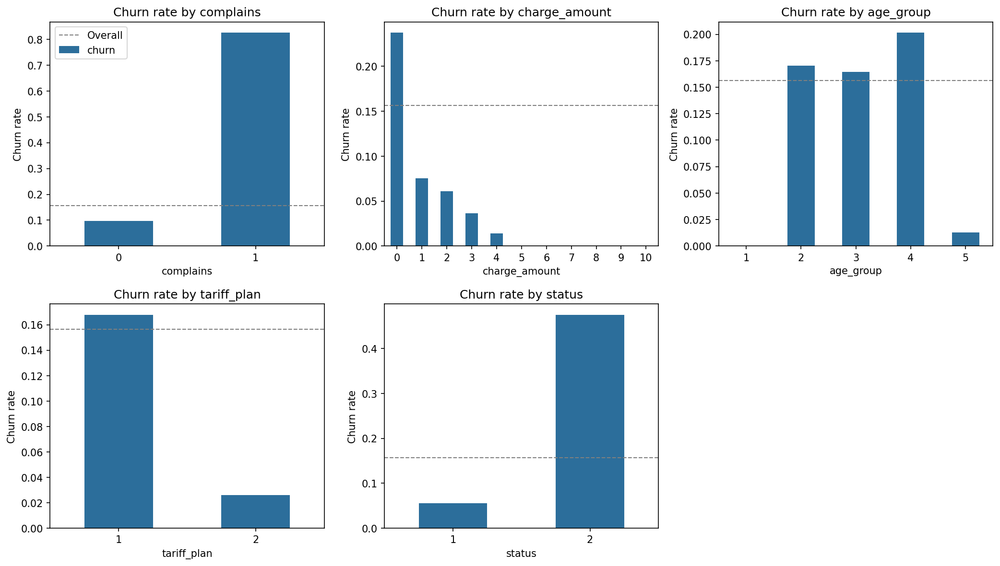
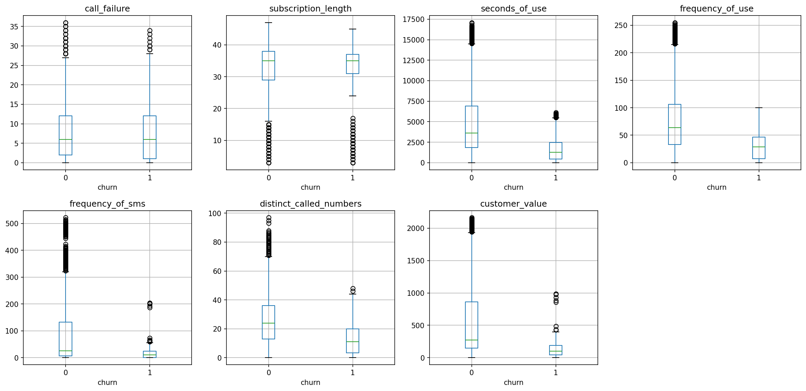
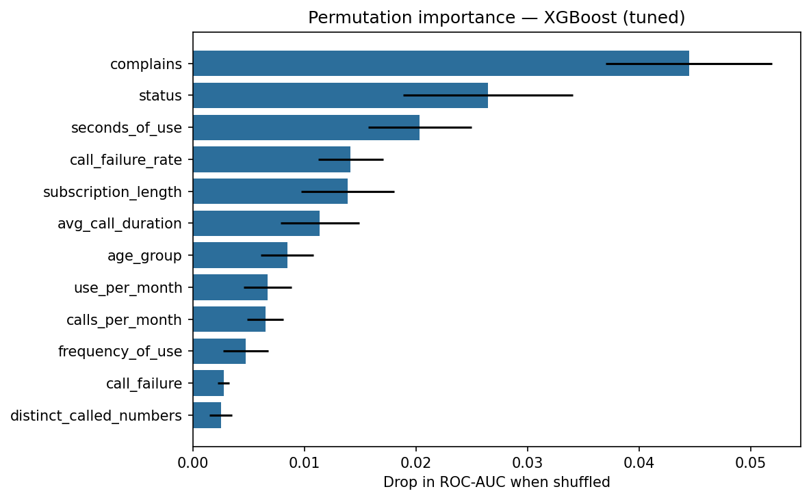
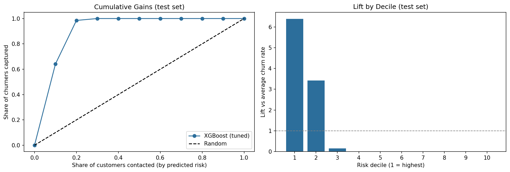

# Telecom Customer Churn Propensity Model

**Which subscribers are about to leave, and who should the retention team contact first?**
This project builds a churn propensity model for a telecom operator, selects it with cross-validation, evaluates it once on a held-out test set, and turns the scores into a risk-by-value targeting plan.

## Project Background
This project is inspired by my professional experience in customer lifecycle analytics and retention strategy in the telecommunications industry.
In my previous role, I worked on customer churn analysis, retention performance, and data-driven decision-making to support customer retention initiatives.
To demonstrate a similar analytical approach while respecting data confidentiality, I independently developed this project using the publicly available UCI Iranian Telecom Churn Dataset.
The project covers feature engineering, churn propensity modeling, model evaluation, and risk-based retention prioritization.
All code, performance metrics, and visualizations presented here are based on public data and do not represent production results from my previous employer.

## Key Results
| | Result |
|---|---|
| **Data** | 3,150 subscribers; 300 exact duplicates removed (2,850 kept); 16% churn rate |
| **Strongest signals** | Complaints (83% churn vs 10%), inactive status (48% vs 6%), pay-as-you-go plan (17% vs 3%), low usage |
| **Model selection** | Tuned XGBoost had the best 5-fold CV score (ROC-AUC 0.988, PR-AUC 0.950), ahead of random forest (0.987 / 0.939) and logistic regression (0.934 / 0.759) |
| **Test performance** (used once) | **ROC-AUC 0.992, PR-AUC 0.962**; at the threshold chosen on validation (0.45): precision 87.7%, recall 85.1% |
| **Targeting** | Contacting the **top 20%** of customers by predicted risk reaches **98.5% of churners** |
| **Segmentation** | No high-risk customer is in the high-value tier. High-risk customers are low to medium value, so retention offers can be tiered by value |

## Approach
**1. Cleaning and EDA**
- Standardized column names, removed 300 duplicate rows before splitting so copies cannot appear in both train and test, dropped `age` (fully redundant with `age_group`)
- Churn rates by complaints, charge level, age group, plan and status; usage distributions by churn; correlation checks

**2. Feature engineering**
- Row-level ratio features: average call duration, SMS share of activity, usage and calls per month of tenure, **call failure rate**, contact diversity

**3. Modeling**
- 70 / 15 / 15 stratified train / validation / test split
- Logistic regression (plain and class-weighted), random forest and XGBoost in a shared scikit-learn pipeline
- 5-fold cross-validated comparison and randomized hyperparameter search on the training set only
- Decision threshold chosen on the validation set; test set used once for the final estimate

**4. Interpretation and robustness**
- Permutation importance on the validation set
- Robustness check without `status`, a feature close to a symptom of churn: CV ROC-AUC only falls from 0.988 to 0.986

**5. Business use**
- Cumulative gains and lift by risk decile
- Risk tier × value tier segmentation with a suggested action for each segment

## Results Gallery
**Churn rate by customer attribute**



**Usage by churn status**



**Feature importance**



**Cumulative gains and lift (test set)**



## Limitations
- Performance is very high partly because complaints and inactive status are strong and close in time to churn. In production, features should be measured well before the churn window to leave time for outreach.
- The data is a single snapshot from one operator; scores should be monitored and revalidated over time.
- A propensity model ranks who is **likely to churn**, not who can be **saved** by an offer. Finding customers who respond to retention offers requires an experiment and an uplift model.

## Repository Structure
```
Churn_Propensity/
├── README.md
├── requirements.txt
├── data/
│   └── customer_churn.csv
├── images/                     # figures used in this README
└── notebooks/
    └── churn_propensity.ipynb
```

## Data
Iranian telecom customer churn dataset from the UCI Machine Learning Repository: 3,150 customers, usage aggregated over 9 months, churn labelled at month 12. Coded fields: `complains` (1 = complaint filed), `tariff_plan` (1 = pay-as-you-go, 2 = contractual), `status` (1 = active, 2 = inactive).


## How to Run
```bash
pip install -r requirements.txt
jupyter notebook notebooks/churn_propensity.ipynb
```

## Tech Stack
Python · pandas · NumPy · scikit-learn · XGBoost · matplotlib
